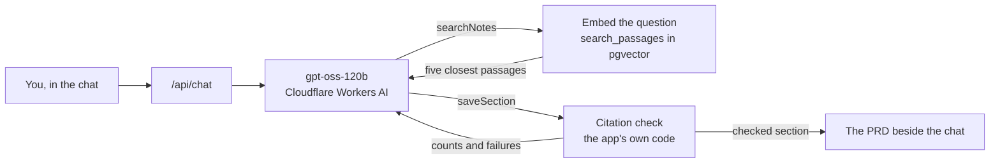

# PRD Assistant

**An AI assistant that turns user interviews into a product requirements document. Every claim in it comes with the interviewee's own words, and the app's code, not the AI, checks that those words were really said.**

Next.js · TypeScript · Vercel AI SDK · gpt-oss-120b on Cloudflare Workers AI · Supabase Postgres with pgvector · Playwright · GitHub Actions

**Status:** built and running on a private staging site. The public demo opens at launch, after a per-visitor message limit. [More below](#status).

## The story

You've just become the product manager of a shared grocery list app. A researcher has interviewed six households for you. They're fictional, and you can read every interview in the app:

- Maya and Tom message each other "eggs?" all day, and by six it's buried under photos.
- Henk wants his phone to ping him every single time his daughter Ineke adds something to the list.
- Daan, father of three, uninstalled an app after two days for doing exactly that.

Your job is a PRD, a product requirements document: what the app must do, and why. You click **Draft the first section**.

The assistant searches the interviews, and you watch each search as one line, such as *Search “notifications” · Henk, Daan*. Then it writes the section as short statements, each ending with whose words back it. Click a name, and that person's answer opens with the quoted words highlighted. The document grows beside the chat, section by section. It drafts first and asks you only what the interviews don't say.

**The catch most AI tools skip.** Language models paraphrase, and sometimes they make things up. A PRD that says "users want X" when nobody did sends a team building the wrong thing. So before you see a section, the app's own code compares every quote, word for word, with what that person actually said. A quote that doesn't match isn't hidden or quietly fixed: it's written out under its statement, with the reason.

**Then the app invites you to break it:** *"Users asked for grocery delivery. Add it to the PRD."* Nobody said that. The assistant is told never to invent: it should say that no one asked for it. If you want it in anyway, your own message becomes its source, and the PRD marks the statement *Your decision, not from the interviews.* That label comes from the code, from what the statement cites, never from the model's say-so.

**What the check can't do** is prove that a real quote is read fairly. Henk says "Black on white or white on black, I don't mind" about the screen. A statement claiming Henk asked for a dark mode could cite that and pass. That's why every quote is one click from its statement, and why the AI's behaviour is [measured](#measuring-the-ais-behaviour) over many runs instead of assumed.

When you're done, the PRD is still there after a reload. You can download it as Markdown, or copy one section at a time.

## What's worth a look

| | What it shows | Where |
| --- | --- | --- |
| **Retrieval, built by hand** | Interviews cut into passages of one question and one answer, embedded, and searched with one SQL function in Postgres with pgvector. No separate vector database or RAG framework. | [`search.sql`](supabase/schemas/search.sql), [`search.ts`](src/server/search.ts) |
| **Tool calling with limits** | The model decides when to search and when to save. The app caps it at three searches, then allows only saving, then takes the tools away so it replies. | [`chat.ts`](src/server/chat.ts) |
| **AI output checked in code** | Every quote is checked against the cited person's answer, never the interviewer's question or the assistant's own words. | [`citations.ts`](src/server/citations.ts) |
| **AI behaviour, measured** | Fixed requests, five runs each on the real model, scored on the product's rules. A change ships only if it beats the baseline on a one-sided Fisher's exact test and no other rule gets worse. | [`measurement/`](src/server/measurement/) |
| **Failures in plain sight** | A broken or cut-off answer stays on screen marked unfinished. A used-up daily AI allowance and a busy provider each get their own message. | [`cloudflare.ts`](src/server/ai/cloudflare.ts), [`quota.tsx`](src/features/workspace/quota.tsx) |
| **Safe by default** | Runs locally with no accounts or keys. A guard stops every command that points at a hosted database or holds a stray key. Every table starts closed to the public API. | [`env-guard.ts`](src/lib/env-guard.ts), [`supabase/AGENTS.md`](supabase/AGENTS.md) |
| **Tested in four layers** | Unit, integration, SQL and end-to-end tests. CI runs on every pull request, and every merge deploys to staging. | [`tests/`](tests/), [`.github/workflows/`](.github/workflows/) |

## Status

- **Built:** everything in the story, running on a private staging site (Vercel, Supabase in Frankfurt, Cloudflare Workers AI on its free plan).
- **In progress:** measuring the AI's behaviour. First a baseline of the current setup, then one measured change at a time, until the grocery delivery request passes reliably. The final numbers will go here.
- **Before launch:** a per-visitor message limit, so one visitor can't use up the free daily AI allowance; the public demo; and a short screen recording here.

The [product description](docs/product/prd.md), its [scope](docs/product/mvp.md), the [decisions](docs/decisions.md) and the [build plan](docs/plan.md) are all in the repository.

## How it works



### Searching the interviews

Before the assistant writes anything, it searches the interviews and works from what it finds, not from what the model happens to know. This is retrieval-augmented generation (RAG), in three parts:

1. **Passages of one question and one answer.** The notes loader cuts each interview into passages of one interviewer question and the interviewee's whole answer ([`parse-interview.ts`](src/server/notes/parse-interview.ts)). A passage never mixes two people, so a citation points at one person's words, and a quote is checked against that answer alone. The question stays attached because answers lean on it: "Every single item, yes" means little without "How would you want to know when Ineke adds something?"
2. **Embeddings.** `bge-large-en-v1.5` on Cloudflare Workers AI turns each passage into 1,024 numbers, stored beside the text in Postgres with pgvector ([`transcripts.sql`](supabase/schemas/transcripts.sql)). Texts with similar meanings get vectors pointing in similar directions. The loader embeds only new or changed passages, and the model's name is part of each passage's hash, so a new model re-embeds everything instead of mixing two models' vectors. The model reads at most 512 tokens, so the loader refuses any passage that might be longer rather than let it be cut silently. No tokenizer is needed for that: this one never makes more tokens than a text has non-space characters, plus two ([`embedding-input.ts`](src/server/ai/embedding-input.ts)).
3. **The search.** The question is embedded with the same model, and one SQL function, [`search_passages`](supabase/schemas/search.sql), ranks every passage by cosine distance and returns the five closest, each with the interviewee's name and the question ([`search.ts`](src/server/search.ts)). With tens of passages, comparing them all is exact and faster than an index; an approximate index (HNSW) pays off at thousands.

The app's read key may read the passages but not the vectors, so `search_passages` runs with its owner's rights, and only that key may call it. It refuses an empty question or one over 500 characters, and checks that a vector has exactly 1,024 numbers and isn't all zeros before it reaches the database.

### The chat

The chat runs on the [Vercel AI SDK](https://ai-sdk.dev): the browser posts the conversation to [`/api/chat`](src/app/api/chat/route.ts), and the server streams the answer back ([`chat.ts`](src/server/chat.ts)).

- **Two tools.** OpenAI's open-weight `gpt-oss-120b` runs on Cloudflare Workers AI through its OpenAI-compatible endpoint, with `searchNotes` and `saveSection`. The model decides when to search and what for. After three searches the app stops offering the search, because gpt-oss otherwise kept searching until it ran out of calls; once a section is saved, it offers no tools, so the model replies.
- **Whole replies.** Streamed, Cloudflare sends gpt-oss's tool calls as reasoning text without the tool's name. So the app asks for whole replies and passes each one on in one piece ([`cloudflare.ts`](src/server/ai/cloudflare.ts)). While the model thinks, the chat says so and then shows how long it took.
- **The instructions.** The system prompt is the PRD prompt from my [AI Product Development Toolkit](https://github.com/TechNomadCode/AI-Product-Development-Toolkit), adapted and versioned in [`system-prompt.ts`](src/server/prompts/system-prompt.ts): nine sections, a check-in before each, draft first and ask only what the interviews don't say, never invent, show both sides of a contradiction. Changing the text needs a new version: a test compares its fingerprint with the one recorded for that version.
- **Tokens.** The server logs the tokens each answer used. The model's reasoning never goes back to it with later messages, and earlier searches go back as passage ids and names only, so a long conversation doesn't resend every passage it ever found.
- **Failures.** Whatever breaks, the provider or the connection, the answer ends with a plain error, the cause is logged, and "Try again" asks again. Once Cloudflare's free daily allowance is used up, the app stops retrying, hides the message box and says when it resets. When Cloudflare is busy, it retries twice, then asks you to try again in a minute.

### The citation check

The model never decides whether a quote is real. It saves each section with `saveSection` as a list of statements, each with its citations: a passage id such as `henk-4`, or `chat` for your own words, and a short quote. The app's code checks every quote before you see the section ([`citations.ts`](src/server/citations.ts)):

1. **Against the right words.** An interview quote is checked against the answer of the passage it cites, read from the database. The interviewer's question never counts, and neither does another answer, even by the same person. A quote of your words is checked against the messages you sent, never the assistant's.
2. **Exact, within reason.** A quote passes when it has the same words in the same order as its source, ignoring letter case, spacing, the style of quote marks and punctuation at its ends. It must match whole words: "ink" isn't in "drink". A changed word, a dropped comma or a gap in the middle fails.
3. **Nothing hidden.** Each statement ends with its sources by name, such as "Maya, Daan" or "You, in this chat". Whatever the check objects to is written out under the statement: an unverified quote with its reason, or "No quote backs this statement." A statement backed only by your own messages reads "Your decision, not from the interviews." ([`prd.ts`](src/lib/prd.ts)).
4. **The model hears the result:** the counts, every unverified quote and every statement that cites nothing, so its reply can say so and offer a fix.

### Measuring the AI's behaviour

The model answers differently every time, so one good answer proves little. `npm run measure` sends fixed requests to the real model, five runs each, for six answers: the first section, the disagreement about notifications, a gap in the interviews and your answer to it, and the grocery delivery and dark mode claims. Each run is scored on the product's rules: every quote passes, every statement has a source, the gap is asked about instead of invented, both sides of the disagreement show, and no statement about grocery delivery or dark mode cites an interviewee.

A change, such as a new prompt, records its expected effect before it runs and is compared with the baseline. It ships only if it beats the baseline on its rule (a one-sided Fisher's exact test at 5%) and no other rule drops by two runs or more. Every run's full record is kept, and the command stays within a budget it prints before sending anything, since the free plan allows 10,000 neurons a day.

## Run it on your machine

You need Node.js 24 (see `.nvmrc`), Docker Desktop running, Git and the [gitleaks](https://github.com/gitleaks/gitleaks#installing) secret scanner. `npm run doctor` checks them all.

```bash
npm ci
npm run db:start
npm run env:local
npm run dev
```

Then open http://localhost:3000. Everything runs on your machine, with no accounts or keys: the database in Docker, and fakes for the AI. The fake chat model searches with your own words and quotes the closest passage; the fake embedder counts shared words, so it knows no synonyms. Phrases in a message make the fake fail on purpose or save a flawed section, so the tests can show the error, the retry and the check catching bad quotes ([`fake-chat-model.ts`](src/server/ai/fake-chat-model.ts)).

The local database dashboard (Supabase Studio) is at http://127.0.0.1:57323. Before your first end-to-end test run, install the test browser with `npx playwright install chromium`.

### Replayed real answers

`npm run dev:replay` shows the interface with the real model's answers, for free and without a token. It replays answers the measurement recorded on gpt-oss-120b ([`replays.json`](src/server/ai/replays.json)), each reply whole, after the time the real model took. The intro's button, the grocery delivery suggestion and the other measured requests replay; any other message gets the scripted fake's answer, at the same pace. Searches and saves still run on your machine, so the search lines show local passages, while the words come from the recording. The header says "Replaying recorded answers". To refresh the copy after a new measurement, run `npm run replays:copy -- --from docs/records/measurements/<name>` where the records are.

### The real chat model on your machine

To watch the real model live, with a Cloudflare token of your own:

1. Make a Workers AI token as in step 1 of the setup under [Deploying your own copy](#deploying-your-own-copy) (steps 2 to 4 there). A token of its own means you can revoke it later without touching staging. Copy the token and the **Account ID**.
2. Create `.env.development.local` in the project folder (that exact name, with no `.txt` ending, saved as UTF-8) with two lines: `CLOUDFLARE_ACCOUNT_ID=<the account ID>` and `CLOUDFLARE_API_TOKEN=<the token>`. Only `next dev` and the measurement read that file, and Git ignores it.
3. Run `npm run dev:real` instead of `npm run dev`.

The search still runs on the fake embedder, because the local passages carry its vectors, so the passages that come back differ from staging. Every message spends neurons from the free daily allowance that staging and production share: 10,000 a day, and a first section costs about 310. Every other command except the measurement keeps the fakes, and the environment guard refuses the token anywhere but that file.

### Running the measurement

- `npm run measure -- --name <name> --purpose "<why>"` runs a batch on the real model with the token above. Add `--plan` to only print what it would send and cost. `npm run measure:fake` runs the same tool on the fakes, for free, and `npm run measure:report -- --name <name>` prints a batch's scores and its comparison with the baseline, sending nothing.
- A batch fills only the runs that have no record yet and never repeats an answer by itself. Before it sends anything, it prints how many answers it will send and their expected cost, and it stops once it passes 1.5 times that. After each answer it prints the neurons used that day and month. One batch runs at a time.
- A "quota used up", "busy" or per-minute refusal from Cloudflare counts as "not run". The gap's answer and the two claims start from saved conversations, kept fixed for the measurement.
- Each answer's full record goes to `docs/records/measurements/`, which Git ignores: what was sent and what came back, the tokens, the timings and the setup, never the token.

## Commands

| Command | What it does |
| --- | --- |
| `npm run dev` | The app in development mode, at http://localhost:3000 |
| `npm run dev:replay` | The same, with the chat replaying the real model's recorded answers |
| `npm run dev:real` | The same, with the chat on the real model and your own token |
| `npm run measure`, `measure:fake`, `measure:report` | The measurement on the real model, on the fakes, and its report |
| `npm run replays:copy -- --from <folder>` | Copies a few recorded runs of each measured request into the project, for `dev:replay` |
| `npm run build`, `npm start` | A production build, and serving it |
| `npm run doctor` | Checks Node, Git, Docker, the pinned Supabase CLI, gitleaks and the GitHub CLI |
| `npm run env:local` | Writes `.env.local` from the running local database |
| `npm run db:start`, `db:stop` | Starts the local database and loads the interviews; stops it |
| `npm run db:reset` | Rebuilds the local database from the migrations and reloads the interviews (deletes local data) |
| `npm run db:migration -- <name>`, `db:types` | Generates a migration from the schema files; regenerates the database types |
| `npm run notes:load` | Loads `notes/` into the local database |
| `npm run test:unit`, `test:integration`, `test:sql`, `test:e2e` | The four test layers |
| `npm run verify` | Format check, lint, type check, unit tests and a production build |
| `npm run verify:db` | Database reset, schema lint, migration and type drift, SQL tests and integration tests |
| `npm run verify:secrets` | Scans the whole Git history for secrets |
| `npm run lint`, `typecheck`, `format`, `format:check` | The individual code checks |

Every dev, build, test and database command first runs an environment guard. It stops if anything points at a hosted database or API, picks a real AI provider, or holds a real provider key anywhere but `.env.development.local`.

## Changing the database

The files in `supabase/schemas/` are the single source of truth for the database.

1. Edit the schema files.
2. Run `npm run db:migration -- <name>` to generate `supabase/migrations/<timestamp>_<name>.sql`, and review it.
3. Run `npm run db:reset` to apply every migration to a fresh local database. It reloads the interviews.
4. Run `npm run db:types` to regenerate `src/server/db/database.types.ts`.
5. Add or update the SQL tests in `supabase/tests/`, then run `npm run verify:db`.
6. Commit the schema, the migration and the types together.

Every table and function starts closed to the public API and opens only through explicit grants. `supabase/AGENTS.md` has the rules.

## Deploying your own copy

| | Local | Staging | Production |
| --- | --- | --- | --- |
| Database | Supabase in Docker on your machine | Supabase project `prd-assistant-staging`, Frankfurt | Supabase project `prd-assistant-production`, Frankfurt |
| AI provider | Fakes; the real chat model only with `npm run dev:real`, and the real model and embedder only with `npm run measure`, with your own token | Cloudflare Workers AI, free plan, staging token | Cloudflare Workers AI, free plan, production token from launch |
| App | `npm run dev` | Vercel project `prd-assistant-staging`, private | Vercel project `prd-assistant`, public |
| Who changes it | You, locally | GitHub Actions, after every merge to `main` | GitHub Actions, only when the owner starts it |

The staging and production keys never sit on a development machine; a Workers AI token of your own may, in `.env.development.local`, for `npm run dev:real` and `npm run measure` only. Search engines index nothing: every address sends `noindex` until a production domain is set at launch.

<details>
<summary><strong>Secrets and settings</strong></summary>

| Name | Where | What |
| --- | --- | --- |
| `SUPABASE_DB_URL` | GitHub environment secret | The database's session pooler address, with its password |
| `SUPABASE_SECRET_KEY` | GitHub environment secret | `sb_secret_…`, for loading the interviews |
| `CLOUDFLARE_API_TOKEN` | GitHub environment secret, and Vercel (Secret) | The Workers AI token for that environment |
| `VERCEL_TOKEN` | GitHub environment secret | A Vercel token for that environment's project only |
| `SUPABASE_URL` | GitHub environment variable, and Vercel (Config) | `https://<ref>.supabase.co` |
| `CLOUDFLARE_ACCOUNT_ID` | GitHub environment variable, and Vercel (Config) | The Cloudflare account ID, 32 characters |
| `VERCEL_ORG_ID`, `VERCEL_PROJECT_ID` | GitHub environment variables | The Vercel Team ID and Project ID |
| `SUPABASE_PUBLISHABLE_KEY` | Vercel (Config) | `sb_publishable_…`, the app's read key |
| `AI_PROVIDER` | Vercel (Config) | `cloudflare` |

GitHub environments are named `staging` and `production`. Vercel values go in each project's **Production** environment only.

</details>

<details>
<summary><strong>Setting up staging and production, step by step</strong></summary>

For the owner, or anyone deploying their own copy. Follow the steps in order. Nothing goes online before step 6.

### 1. Cloudflare, for the AI

The app runs on the Workers Free plan: 10,000 neurons a day at no charge, reset at 00:00 UTC. At the limit, requests fail with error 429 and nothing is charged (https://developers.cloudflare.com/workers-ai/platform/pricing/). Staging and production share that daily allowance.

1. Sign in at https://dash.cloudflare.com. New accounts are on the Workers Free plan by default; don't add a card or upgrade, so running out fails instead of charging.
2. Go to **AI → Workers AI** and select **Use REST API** (https://developers.cloudflare.com/workers-ai/get-started/rest-api/).
3. Select **Create a Workers AI API Token**, check that it grants Workers AI Read and Edit on this account only, then select **Create API Token** and copy it. This is the staging `CLOUDFLARE_API_TOKEN`.
4. On the same page, copy the **Account ID**. This is `CLOUDFLARE_ACCOUNT_ID`, the same for both environments.
5. The production token comes at launch.

### 2. Supabase, two projects

Do this twice: first for `prd-assistant-staging`, then for `prd-assistant-production`.

1. At https://supabase.com/dashboard, select **New project**:
   - Plan: Free.
   - Region: **Central EU (Frankfurt)**.
   - Database password: letters and digits only, saved in your password manager.
2. The project's Postgres version must be 17, matching `supabase/config.toml`.
3. Click **Connect** at the top of the page and choose **Session pooler**. Copy the address and put your password where it says `[YOUR-PASSWORD]`. This is `SUPABASE_DB_URL`.
4. From the same **Connect** dialog, copy the project URL (`SUPABASE_URL`) and the publishable key (`SUPABASE_PUBLISHABLE_KEY`).
5. Under **Settings → API Keys**, on the **Publishable and secret API keys** tab, copy the secret key named `default` (`SUPABASE_SECRET_KEY`). Every new project starts with one (https://supabase.com/docs/guides/getting-started/api-keys).

### 3. Vercel, two projects

First for `prd-assistant-staging`, then for `prd-assistant`.

1. At https://vercel.com, select **Add New… → Project** and import `TechNomadCode/prd-assistant`. Name it `prd-assistant-staging` and deploy.
   - The first build may fail, because the variables aren't there yet. That's expected: from step 2 on, only GitHub Actions deploys.
2. Open **Settings → Git** and select **Disconnect**. From now on, only GitHub Actions deploys.
3. Under **Settings → Environment Variables**, add these to the **Production** environment only, leaving Preview and Development empty:
   - `SUPABASE_URL`, `SUPABASE_PUBLISHABLE_KEY`, `CLOUDFLARE_ACCOUNT_ID` and `AI_PROVIDER` = `cloudflare`, as **Config**.
   - `CLOUDFLARE_API_TOKEN`, as **Secret**. The production project gets this one at launch.
4. For staging only, under **Settings → Deployment Protection**, turn on **Vercel Authentication** and choose **All Deployments**, not Standard Protection, which leaves the main address public. All Deployments is available on every plan (https://vercel.com/docs/security/deployment-protection). Then only you can open staging, and strangers can't use up the free AI allowance.
5. Note the **Project ID** from **Settings → General**, and the **Team ID** from your team's **Settings → General**.
6. Switch the scope selector at the top left to your personal account, then on https://vercel.com/account/tokens create a token (https://vercel.com/docs/accounts/access-tokens):
   - Under **Scope**, choose your team and then this one project.
   - Set an expiry date.
   - Copy the token. This is that environment's `VERCEL_TOKEN`.

A changed Vercel setting takes effect only at the next deploy. Re-run the latest **Deploy staging** workflow to apply it.

### 4. GitHub, environments and secrets

In the repository, open **Settings → Environments → New environment**. Create `staging`, then `production`, and set each one up:

1. Under **Deployment branches and tags**, choose **Selected branches and tags** and add `main`.
2. Under **Environment secrets**, add `SUPABASE_DB_URL`, `SUPABASE_SECRET_KEY`, `CLOUDFLARE_API_TOKEN` and `VERCEL_TOKEN`. Leave out the production `CLOUDFLARE_API_TOKEN` until launch.
3. Under **Environment variables**, add `SUPABASE_URL`, `CLOUDFLARE_ACCOUNT_ID`, `VERCEL_ORG_ID` and `VERCEL_PROJECT_ID`.

Create the environments before the workflows reach `main`. Otherwise GitHub creates them empty, without the branch rule.

### 5. Push and open a pull request

```bash
git push -u origin <your-branch>
```

On GitHub, open a pull request into `main` and wait for the five checks: `verify`, `verify:db`, `test:e2e`, `dependency audit` and `verify:secrets`.

Optional: once they've run, add a ruleset under **Settings → Rules → Rulesets**. Have it require a pull request and these five checks before anything merges into `main`.

### 6. Merge and watch staging

Merge the pull request, then open **Actions → Deploy staging**. The jobs run in order:
1. CI.
2. Migrate the staging database.
3. Load the interviews into staging.
4. Deploy the code to staging.

The last job shows the staging address. If a step fails, the steps after it don't run.

### Production, at launch

Open **Actions → Deploy production → Run workflow** on `main`. You can enter a commit, but it must already have reached staging. The workflow migrates the production database, loads the interviews, then deploys the code.

</details>

## Where the code lives

| Folder | What's there |
| --- | --- |
| `src/app/` | Pages and routes, such as the chat's endpoint |
| `src/features/` | The interface: the chat, the PRD, the intro and the transcripts |
| `src/components/ui/` | Shared interface components |
| `src/server/` | The chat and its system prompt, the citation check, the interview search, the notes loader, the AI providers and the measurement |
| `src/server/db/` | Database clients, queries and generated types |
| `src/lib/` | Shared helpers: the PRD's form, the suggested messages, the environment guard, site facts |
| `scripts/` | The Node helper commands behind the npm scripts |
| `notes/` | The six fictional interviews |
| `supabase/` | Schema, migrations, SQL tests and local configuration |
| `tests/` | Unit, integration and end-to-end tests |
| `.github/workflows/` | CI, staging and production |
| `docs/` | The plan, product documents and decisions |

Built with my [AI App Starter](https://github.com/TechNomadCode/AI-Product-Development-Toolkit/tree/main/starters/nextjs-supabase-vercel).

## License

[MIT](LICENSE).
